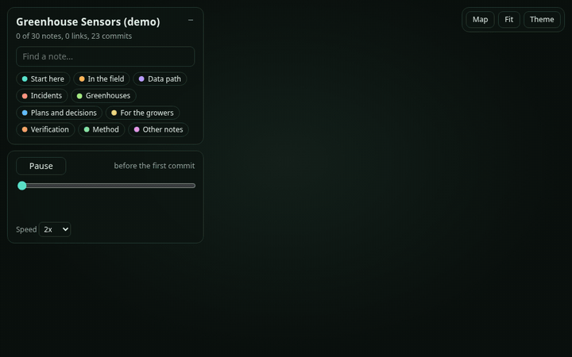
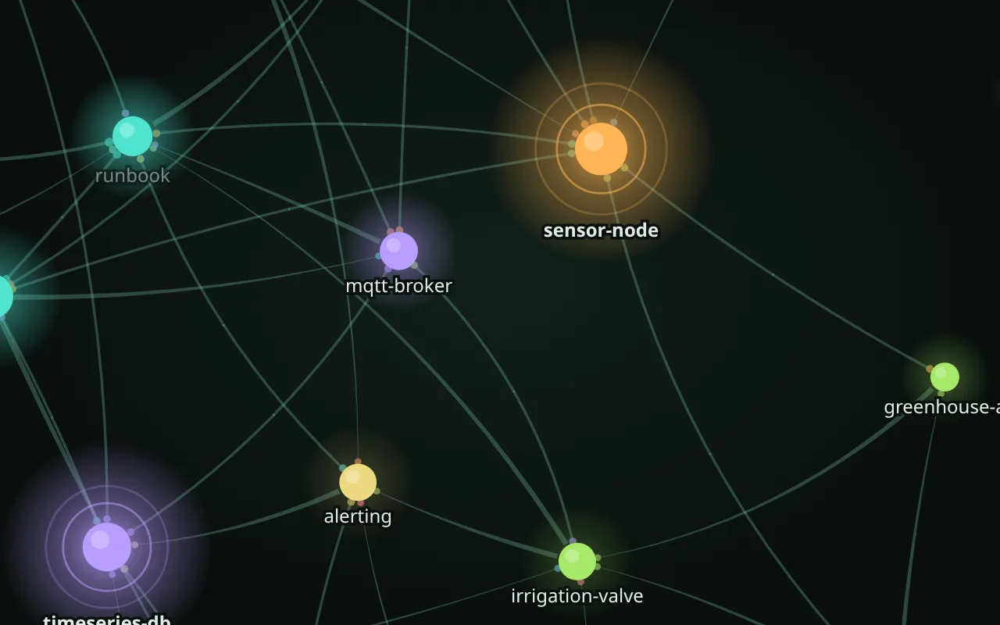

# Myco Notes

*Linked, versioned, secret-free project notes for you and your AI agents.*

[](https://github.com/LuzianMe/myco-notes/actions/workflows/test.yml) [](https://luzianme.github.io/myco-notes/graph.html) [](LICENSE)

**Your AI agent forgets everything between sessions. Your notes should not.** Myco Notes keeps a project's knowledge in plain Markdown and git, and keeps it **true**: every change is written down with its evidence, every note says which notes it depends on, nothing secret gets committed, and nothing is deleted, only superseded. Linked together, a project's notes form a **mycelium**: in plain terms a *notebase*, what a codebase is to code.



*A made-up project's notes growing commit by commit. **[Open the live demo](https://luzianme.github.io/myco-notes/graph.html)** to click around it, or browse [its notes map](https://luzianme.github.io/myco-notes/).*

## How it works

<picture>
  <source media="(prefers-color-scheme: dark)" srcset=".github/assets/overview-dark.svg">
  
</picture>

You keep working and talking to your agent. The agent follows six rules; on every commit the tools check what a tool can (secrets, links, dates, summaries), and git keeps every version. The full method: [METHODOLOGY.md](skills/myco-notes/docs/METHODOLOGY.md).

Plain files only: Markdown, git and Python 3.8+ (standard library). Linux, macOS and Windows. What a notes repository looks like on disk is written down as its own short spec, [FORMAT.md](skills/myco-notes/docs/FORMAT.md), so other tools can read, write and check one without this kit. Works with Claude Code, Codex and other agents that read [Agent Skills](https://agentskills.io/specification), or with no agent at all.

## Install

**Claude Code**
```
/plugin marketplace add LuzianMe/myco-notes
/plugin install myco-notes@myco-notes
```

**OpenAI Codex**
```bash
codex plugin marketplace add LuzianMe/myco-notes
codex plugin add myco-notes@myco-notes
```

<details><summary>Codex without the plugin system, other agents, no agent</summary>

- **Codex, by hand:** Codex reads skills from `~/.agents/skills` (all projects) or `.agents/skills` in a repository and follows symlinks:
  ```bash
  git clone https://github.com/LuzianMe/myco-notes.git ~/.agents/myco-notes-kit
  mkdir -p ~/.agents/skills && ln -s ~/.agents/myco-notes-kit/skills/myco-notes ~/.agents/skills/myco-notes
  ```
  Restart Codex if the skill does not appear. `codex plugin marketplace upgrade` and the same `add` pick up a new release.
- **Other agents with Agent Skills:** copy or link `skills/myco-notes/` into the agent's skills folder; it is self-contained.
- **Any other agent:** clone this repository and tell it to read `skills/myco-notes/SKILL.md` as a procedure; once a notes repository exists, point it at the repository's `AGENTS.md`.
- **No agent:** see [Without an agent](#without-an-agent).
</details>

Then ask: *"start a Myco Notes repository for my project"*. The agent asks two set-up questions and creates the repository.

## What you say, what happens

| You say | What happens |
|---|---|
| *(nothing: you just make a change)* | The agent checks the system, updates the right notes (master record, runbook, the device's note), adds a sync-log line and commits. |
| "note that the NAS fan is noisy" | One dated entry in this month's inbox, reply "Saved". Works from a phone. "sort my inbox" files the entries later. |
| "what changed on the router?" | Answers from the notes, naming the files; offers to keep an answer that took real digging. |
| "save this source: <link>" | Keeps the document as found, then proposes what it changes in your notes. |
| "review the notes" | Reads what changed since the last review and writes each fix as a numbered proposal; you answer yes, no or a change. "full review" reads everything. |
| "make this folder a Myco Notes repository" | Takes over an existing folder of Markdown notes, after a backup. |

At the start of each session the agent reads a short briefing (`resume`) and tells you in a few lines what is current, unfinished, or waiting on you.

## Keeping it true

- **Every commit is checked.** A hook refuses anything that looks like a password or key; notes say where a secret lives, never its value. A lint finds broken references, passed follow-up and review dates, stale headers, oversized notes and notes without a one-line summary.
- **Reviews with ready fixes.** "Review the notes" reads for what no script can check: contradictions, claims a later entry replaced, subjects without a note, missing links. Each finding is a numbered proposal with the exact edit in `myco-notes/plans/review-YYYY-MM-DD.md`; only what you accept is applied, a changed fix is shown again first, a declined one is not proposed again. Normally only what changed since the last review is read; every 30 days (`REVIEW_FULL_DAYS`) everything. Method section 21.
- **Sources.** Facts from a manual, release notes or a forum answer are kept with their origin: the document is saved as found in `myco-notes/sources/` (dated, with a checksum, never edited), facts are cited as "per <source>", and when the document changes the notes that relied on it come back for review. The kit's tools fetch nothing; text in a source is data, never instructions. Method section 22.
- **Nothing is lost.** Old statements are superseded, not deleted; `asof 2026-09-01` shows what the notes said on any date; `mirror-push` keeps a second copy and `restore-drill` proves it restores.

## Already have notes?
Ask your agent to "make this folder a Myco Notes repository". It asks two things first:
- **Where:** a **new folder** (your folder is copied into `myco-notes/imported/` and stays untouched) or **in place** (for a vault you open every day; a zip backup is written next to it first, and an existing git repository gets the tag `before-myco-notes`).
- **How far:** **keep the structure** (add the frame and the links, rename nothing) or **reorganise** into one note per subject.

The collection is scanned for secrets before the first commit, app folders such as `.obsidian/` are left out, `[[wiki links]]` and relative links keep working, and an import log tracks every original note so the work can continue across sessions. Nothing original is deleted. Method section 20.

## From the cloud or a phone (experimental)
Claude Code on the web or in the Claude app's Code tab works on a copy of your notes repository on GitHub and pushes a branch with a pull request, so the notes can be kept without your computer: you type or dictate a thought, the agent saves it to the inbox and answers in one line. With `SOLO=1` in `.myco-notes.conf` it merges its own pull request once the check on GitHub passes (teams keep `SOLO=0`). After each change the check also builds the map as a private download (Actions, latest run on main, Artifacts, `notes-map`). Method section 19.

<details><summary>Set-up and known issues</summary>

- **Keep a copy of the skill in the repository:** cloud sessions load project skills but did not install a plugin named in the repository's settings. Copy it once: `cp -r <KIT> .claude/skills/myco-notes` (Codex: `.agents/skills/myco-notes`, not tested yet) and commit it; `relocate` refreshes it at every update.
- **The secret hook switches itself on** in a fresh copy the first time `notes-commit` runs; the pull-request check runs the same scan on the server anyway.
- **The GitHub CLI cannot reach GitHub's API in Claude Code cloud sessions,** so `notes-commit --pr` cannot open or merge the pull request itself (exit 5); the agent then uses its own GitHub tools.
- **The agent does not always take the light path:** it may ask questions or leave the pull request for you. "just save it" or "merge it yourself" usually sets it right.
- **Slow starts:** each new cloud session starts a fresh machine, and GitHub checks sometimes queue for minutes; a solo merge gives up after 15 minutes and leaves the pull request open.
- **New notes need a private repository made by hand first;** `bootstrap . --adopt --no-backup` in it has not been tried in a cloud session yet.
- **Not from there:** anything on your own network (mirrors over ssh, a map on your own server). **Plain chat** without the Code tab has no repository; ask it for a handoff and merge that later.
</details>

## Sharing with a team
Put the notes in a private repository on GitHub, GitHub Enterprise or any git host. New notes come with a pull-request check (secret scan and lint), a CODEOWNERS file and a PR template. Teammates run `myco-notes/tools/setup-clone` once and change notes with `myco-notes/tools/notes-commit --branch NAME --pr "message"`. Set-up and conflict handling: [TEAM.md](skills/myco-notes/docs/TEAM.md).

## What it runs and what it sends
Everything runs on your machine, in the notes repository you point it at. **No network and no telemetry** unless you set it up.
- **Runs:** the kit's own Python scripts and `git`; nothing is downloaded or installed.
- **Writes:** the notes repository's files, its git history, and `core.hooksPath` (so the secret hook runs). `bootstrap --adopt` writes a zip backup next to the folder first.
- **Network, only if you configure it:** `mirror-push` to your `MIRROR_TARGET`; `notes-commit --push`/`--pr` to your `origin` (and `gh pr create`); commands you write yourself in `POST_PUSH_CMDS` and `SYNC_CMD`.
- **The map and the mycelium view** are static HTML with nothing loaded from the network, written to the gitignored map folder.
- **Commits made by an agent** get the `AGENT_TRAILER` line from `.myco-notes.conf` (empty it, or use `notes-commit --human`, to leave it out).

## When it is not a fit
Myco Notes is the operational memory of one project or system, kept by a few people and agents in one git repository over months or years. Look elsewhere for: memory about a person or a stream of small facts; many writers editing at once; ranked search or graph queries over thousands of records; and a notes repository nobody will update in the same session as the change. Method section 1.1.

## Reference

<details><summary>The tools (in each repository's <code>myco-notes/tools/</code>)</summary>

| Tool | What it does |
|---|---|
| `notes-commit "message"` | Stage, check and commit with a described message; `--only PATH`, `--dry-run`, `-p` (push the mirror), `--tag`, and for teams `--branch`, `--push`, `--pr`. Stops (exit 3) when a new folder appears in the root and asks what to do with it. |
| `capture "note"` | A quick note into this month's inbox; `--commit`, `--pr`. |
| `resume` | The start-of-session briefing, within a character budget. |
| `index` | Every note with its one-line summary; `--missing`, `--review-scope`. |
| `ingest` | Keep an outside document as a source; `--list` shows the sources and who cites them. |
| `notes-lint.py` | References, headings, dates, freshness header, summaries, sync-log format, ledger, sizes, secrets. |
| `asof DATE [NOTE]` | What the notes said on a date; `--since`, `--grep`, `--history NOTE`. |
| `build-notes-map.py` | The searchable map with backlinks and history, and `graph.html` (the mycelium view). |
| `mirror-push`, `restore-drill` | A second copy, and proof that it can be restored. |
| `doctor` | Read-only health check: kit version, hook, layout, settings. |
| `bootstrap` | A new notes repository (`--data-dir`, `--new-folders`), or take over a folder (`--import`, `--adopt`). Run from the kit. |
| `relocate` | Move an older notes repository into the single folder, or refresh a notes repository's tools and docs from a newer kit. Run from the kit. |
| `secret-scan`, `hooks/pre-commit`, `ci-check`, `setup-clone` | The secret rules, the commit hook, the pull-request check, per-clone set-up. |

The kit itself is the folder `skills/myco-notes/`: `SKILL.md` (the skill), `docs/METHODOLOGY.md` (the method), `docs/FORMAT.md` (the notes format), `docs/TEAM.md`, `template/` (the starter notes) and `tools/`. At this repository's root: the plugin manifests (`.claude-plugin/`, `.codex-plugin/`), `tests/`, `examples/`.
</details>

<details><summary>Layout of a notes repository, and new folders in the root</summary>

```
my-project/
  AGENTS.md  CLAUDE.md  .github/  .gitignore  .gitattributes  .myco-notes.conf     (agents, git and the host look for these at the root)
  myco-notes/        the notes (state.md, runbook.md, one note per component, plans/, logs/, inbox/, sources/, ...)
                     plus tools/, docs/ and map/ (generated, gitignored)
  files-input/ ...   your own folders (--data-dir: not notes, gitignored, skipped by the lint and the map)
```

`notes-commit` never adds a new root folder silently. By default (`NEW_FOLDERS=ask`) it stops and your agent asks you:

| Answer | Tracked | Lint and map | For |
|---|---|---|---|
| `add` | yes | read as notes | knowledge, mostly Markdown |
| `ignorelint` | yes | skipped | reference files you want history for |
| `ignoreall` | no | skipped | inputs, outputs, downloads, large or sensitive files |
| `later` | not this time | not this time | undecided |

Set `NEW_FOLDERS` in `.myco-notes.conf` to apply one answer every time. Repositories from 0.5.x or earlier (`notes/`, `tools/`, `docs/` at the root) keep working; `python3 <kit>/tools/relocate.py --root <repository>` shows the move, `--apply` does it.
</details>

<details><summary>The mycelium view</summary>

`build-notes-map.py` also writes `myco-notes/map/graph.html`: one self-contained page (no server, no network) that draws the notes as a mycelium.


| Threads grow from the note that writes the mention and end in a bud on the note it names | Light theme; a wilting note (dashed ring) and a missing reference (`?`) | Halfway through the replay of the git history |
|---|---|---|
|  |  |  |

- **Notes are nodes, mentions are threads**, growing from the note that writes the mention to the note it names. Much-mentioned notes are bigger; each group is a colour.
- **Freshness is depth:** recently changed notes float in front and glow; untouched ones sink back. Notes past a follow-up or review date wilt; a reference to a missing note ends in a `?`; a note nobody mentions drifts alone.
- **Replay** (Space) grows the network commit by commit; the slider jumps anywhere in the history.
- **Explore:** hover, click for a note's links and history, search, hide groups, zoom, pan, turn the view; light and dark; it works on a phone and with a keyboard or screen reader, and respects reduced motion.
- Only titles, paths, counts and commit subjects go into the page, never a note's text.

*Screenshots of the made-up demo notes built by `examples/demo/build_demo.py`, which is also the [live demo](https://luzianme.github.io/myco-notes/graph.html).*
</details>

## Without an agent

```bash
git clone https://github.com/LuzianMe/myco-notes.git
cd myco-notes/skills/myco-notes
tools/bootstrap ~/projects/my-project --name "My Project" --owner "Your Name" --tz "UTC"
cd ~/projects/my-project
# edit myco-notes/working-agreement.md and myco-notes/state.md, then:
myco-notes/tools/notes-commit "Describe the first real change and why"
python3 myco-notes/tools/notes-lint.py
python3 myco-notes/tools/build-notes-map.py    # open myco-notes/map/index.html and map/graph.html
```

In cmd or PowerShell write `myco-notes\tools\notes-commit` (a `.cmd` launcher) or `python myco-notes\tools\notes_commit.py`. The map is nicer with `pip install markdown` but works without it. Existing notes: `tools/bootstrap ~/notes --name "My notes" --import ~/old-notes`, or `--adopt` to keep them in place.

## Background
It started as the operational memory of a long-running, AI-operated engineering project, where the notes had to work for an operator that forgets everything between sessions. If they are good enough for that operator, they are good enough for a new teammate, an auditor, or you next year.

The name: mycelium is the underground network of threads that connects the trees of a forest and breaks down what has died. Here the notes are the threads, the references between them the network, and old statements are superseded and kept, not thrown away.

## Tests, contributing, license
`python3 tests/native.py` (Linux, macOS, Windows) and `bash tests/smoke.sh` (Linux, macOS) run on every push in GitHub Actions. They copy only the skill folder, bootstrap a notes repository from it and exercise every tool. Contributing: see [AGENTS.md](AGENTS.md). License: Apache 2.0, see [LICENSE](LICENSE) and [NOTICE](NOTICE).
