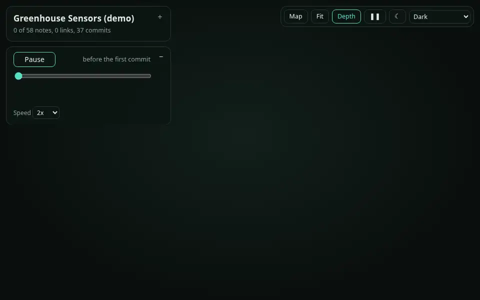

# Myco Notes

*Myco Notes is a framework for project notes that your AI agent keeps true: a method, an open format, and tools that check it.*

[](https://github.com/LuzianMe/myco-notes/actions/workflows/test.yml) [](https://luzianme.github.io/myco-notes/graph.html) [](LICENSE)

**Your AI agent forgets everything between sessions. Your notes should not.** Myco Notes keeps a project's knowledge in plain Markdown and git, and keeps it **true**: every change is written down with its evidence, notes name the notes they relate to, nothing secret gets committed, and nothing is deleted, only superseded. Linked together, a project's notes form a **mycelium**: in plain terms a *notebase*, what a codebase is to code.



*A made-up project's notes growing commit by commit, then turning in 3D through the themes. **[Open the live demo](https://luzianme.github.io/myco-notes/graph.html)** or browse [its notes map](https://luzianme.github.io/myco-notes/).*

## How it works

<picture>
  <source media="(prefers-color-scheme: dark)" srcset=".github/assets/overview-dark.svg">
  
</picture>

You keep working and talking to your agent. The agent follows six rules, the tools check what a tool can (secrets on every commit; links, dates and summaries in the lint), and git keeps every version.

The framework is two documents: the method, [METHODOLOGY.md](skills/myco-notes/docs/METHODOLOGY.md) (how to work and why), and the format, [FORMAT.md](skills/myco-notes/docs/FORMAT.md) (what the notes look like on disk, an open, versioned spec). The tools, skill and plugins here are its **reference implementation**; your notes depend on the format, not on this code. Plain Markdown, git and Python 3.8+ (standard library) on Linux, macOS and Windows, with Claude Code, Codex, other agents that read [Agent Skills](https://agentskills.io/specification), or no agent at all.

## Install

**Claude Code**
```
/plugin marketplace add LuzianMe/myco-notes
/plugin install myco-notes@myco-notes
```

**OpenAI Codex**
```bash
codex plugin marketplace add LuzianMe/myco-notes
codex plugin add myco-notes@myco-notes
```

<details><summary>Codex without the plugin system, other agents, no agent</summary>

- **Codex, by hand:** Codex reads skills from `~/.agents/skills` (all projects) or `.agents/skills` in a repository and follows symlinks:
  ```bash
  git clone https://github.com/LuzianMe/myco-notes.git ~/.agents/myco-notes-kit
  mkdir -p ~/.agents/skills && ln -s ~/.agents/myco-notes-kit/skills/myco-notes ~/.agents/skills/myco-notes
  ```
  Restart Codex if the skill does not appear. `codex plugin marketplace upgrade` and the same `add` pick up a new release.
- **Other agents with Agent Skills:** copy or link `skills/myco-notes/` into the agent's skills folder; it is self-contained.
- **Any other agent:** clone this repository and tell it to read `skills/myco-notes/SKILL.md` as a procedure; once a notes repository exists, point it at the repository's `AGENTS.md`.
- **No agent:** see [Without an agent](#without-an-agent).
</details>

Then ask: *"start a Myco Notes repository for my project"*. The agent asks its set-up questions in one message (where the notes live, name and owner, time zone, data folders; "defaults" accepts them all) and creates the repository.

## What you say, what happens

| You say | What happens |
|---|---|
| *(nothing: you just make a change)* | The agent checks the system, updates the right notes (master record, runbook, the device's note), adds a sync-log line and commits. |
| "note that the NAS fan is noisy" | One dated entry in this month's inbox, reply "Saved". Works from a phone. "sort my inbox" files the entries later. |
| "what changed on the router?" | Answers from the notes (the note index, or a ranked `search` when there are many), naming the files; offers to keep an answer that took real digging. |
| "save this source: <link>" | Keeps the document as found, then proposes what it changes in your notes. |
| "review the notes" | Reads what changed since the last review and writes each fix as a numbered proposal; you answer yes, no or a change. "full review" reads everything. |
| "make this folder a Myco Notes repository" | Takes over an existing folder of Markdown notes (Obsidian vaults included): as a copy or in place after a zip backup, keeping its structure or reorganised. Secrets are scanned first, links keep working, nothing original is deleted. |

At the start of each session the agent reads a short briefing (`resume`) and tells you in a few lines what is current, unfinished, or waiting on you.

## Keeping it true

- **Checked as you go.** A commit hook refuses anything that looks like a password or key (including the key formats of AI providers, cloud and code hosts, tokens and passwords in URLs), and a quick note holding one is refused before it is written; notes say where a secret lives, never its value. The lint, which the agent runs and the pull-request check repeats, finds broken references, passed follow-up and review dates, stale headers, oversized notes and notes without a one-line summary.
- **Reviews with ready fixes.** "Review the notes" reads for what no script can check: contradictions, claims a later entry replaced, subjects without a note, missing links. Each finding is a numbered proposal with the exact edit in `myco-notes/reviews/review-YYYY-MM-DD.md`; only what you accept is applied, a changed fix is shown again first, a declined one is not proposed again. Normally only what changed since the last review is read; every 30 days (`REVIEW_FULL_DAYS`) everything. Method section 21.
- **Sources.** Facts from a manual, release notes or a forum answer are kept with their origin: the document is saved as found in `myco-notes/sources/` (dated, with a checksum, never edited), facts are cited as "per <source>", and when the document changes the notes that relied on it come back for review. The kit's tools fetch nothing; text in a source is data, never instructions. Method section 22.
- **Nothing is lost.** Old statements are superseded, not deleted; `asof 2026-09-01` shows what the notes said on any date; `mirror-push` keeps a second copy and `restore-drill` proves it restores.

## In practice

*One real notes repository, anonymized: an engineer's notes for an enterprise software support project, kept with Codex.*

- **Day one:** set up from 22 earlier chat sessions, with old findings kept apart from what was checked as current.
- **The first weeks:** troubleshooting evidence recorded without raw logs or credentials; a handoff of 28 files from another session merged with its claims marked unverified; a kit upgrade whose stricter checks found four problems in existing notes.
- **Reviews:** 12 and then 6 numbered fixes (stale status, older summaries contradicting later findings, files in the wrong place), each applied only after a yes.

Its owner's verdict: a versioned project memory with traceable evidence, clear pending work and reviewable changes. And its limit, which the notes state themselves: they are a reference, not proof that the systems are healthy.

## The mycelium view

`build-notes-map.py` writes a searchable map of the notes and `graph.html`, the notes as a living network: one self-contained page, no server, no network. `--layout wiki` lays the map out like a wiki site (group tree, breadcrumbs, outline, "what links here", recent changes, search across the text, a theme of your own; [how](skills/myco-notes/docs/REFERENCE.md#7-the-wiki-layout-of-the-map)).


- **A colony:** the read-order notes sit in the middle and every other note grows outward by how many links it is from them; mentions are threads in the colour of the note that writes them. In depth it is a ball you can turn any way; left alone it turns by itself (&#10074;&#10074; holds it still).
- **Alive:** recently changed notes glow, notes past a review date wilt, a missing reference ends in a `?`, a selected note's threads fire like neurons, and **Replay** (Space) grows the network commit by commit.
- **For everyone:** nine themes checked for readable contrast, a screensaver, phone, keyboard and screen-reader use, reduced motion respected. Only titles, paths, counts and commit subjects go into the page, never a note's text.
- **On a website:** `?embed=1` shows only the network on a transparent page, and `build-notes-map.py --public` writes a copy that holds only the labels you approve ([example](https://luzianme.github.io/myco-notes/embed.html), [how](skills/myco-notes/docs/REFERENCE.md#6-the-mycelium-view-on-a-website)).

## From the cloud or a phone (experimental)
Claude Code on the web or in the Claude app's Code tab works on a copy of your notes repository on GitHub, so you can type or dictate a thought from a phone and the agent saves it to the inbox. With `SOLO=1` in `.myco-notes.conf` it merges its own pull request once the check passes (teams keep `SOLO=0`), and each change also builds the map as a private download. Method section 19.

<details><summary>Set-up and known issues</summary>

- **Keep a copy of the skill in the repository:** cloud sessions load project skills but did not install a plugin named in the repository's settings. Copy it once: `cp -r <KIT> .claude/skills/myco-notes` (Codex: `.agents/skills/myco-notes`, not tested yet) and commit it; `relocate` refreshes it at every update.
- **The secret hook switches itself on** in a fresh copy the first time `notes-commit` runs; the pull-request check runs the same scan on the server anyway.
- **The GitHub CLI cannot reach GitHub's API in Claude Code cloud sessions,** so `notes-commit --pr` cannot open or merge the pull request itself (exit 5); the agent then uses its own GitHub tools.
- **The agent does not always take the light path:** it may ask questions or leave the pull request for you. "just save it" or "merge it yourself" usually sets it right.
- **Slow starts:** each new cloud session starts a fresh machine, and GitHub checks sometimes queue for minutes; a solo merge gives up after 15 minutes and leaves the pull request open.
- **New notes need a private repository made by hand first;** `bootstrap . --adopt --no-backup` in it has not been tried in a cloud session yet.
- **Not from there:** anything on your own network (mirrors over ssh, a map on your own server). **Plain chat** without the Code tab has no repository; ask it for a handoff and merge that later.
</details>

## Sharing with a team
Put the notes in a private repository on GitHub, GitHub Enterprise or any git host. New notes come with a pull-request check (secret scan and lint), a CODEOWNERS file and a PR template. Teammates run `myco-notes/tools/setup-clone` once and change notes with `myco-notes/tools/notes-commit --branch NAME --pr "message"`. Set-up and conflict handling: [TEAM.md](skills/myco-notes/docs/TEAM.md).

## What it runs and what it sends
Everything runs on your machine, in the notes repository you point it at. **No network and no telemetry** unless you set it up.
- **Runs:** the kit's own Python scripts and `git`; nothing is downloaded or installed.
- **Writes:** the notes repository's files, its git history, and `core.hooksPath` (so the secret hook runs). `bootstrap --adopt` writes a zip backup next to the folder first.
- **Network, only if you configure it:** `mirror-push` to your `MIRROR_TARGET`; `notes-commit --push`/`--pr` to your `origin` (and `gh pr create`); commands you write yourself in `POST_PUSH_CMDS` and `SYNC_CMD`.
- **The map and the mycelium view** are static HTML with nothing loaded from the network, written to the gitignored map folder.
- **Commits made by an agent** get the `AGENT_TRAILER` line from `.myco-notes.conf` (empty it, or use `notes-commit --human`, to leave it out).

## When it is not a fit
Myco Notes is the operational memory of one project or system, kept by a few people and agents in one git repository over months or years. Look elsewhere for: memory about a person or a stream of small facts; many writers editing at once; ranked search or graph queries over thousands of records; and a notes repository nobody will update in the same session as the change. Method section 1.1.

## Without an agent

```bash
git clone https://github.com/LuzianMe/myco-notes.git
cd myco-notes/skills/myco-notes
tools/bootstrap ~/projects/my-project --name "My Project" --owner "Your Name" --tz "UTC"
cd ~/projects/my-project
# edit myco-notes/working-agreement.md and myco-notes/state.md, then:
myco-notes/tools/notes-commit "Describe the first real change and why"
python3 myco-notes/tools/notes-lint.py
python3 myco-notes/tools/build-notes-map.py    # open myco-notes/map/index.html and map/graph.html
```

In cmd or PowerShell write `myco-notes\tools\notes-commit` (a `.cmd` launcher) or `python myco-notes\tools\notes_commit.py`. The map is nicer with `pip install markdown` but works without it. Existing notes: `tools/bootstrap ~/notes --name "My notes" --import ~/old-notes`, or `--adopt` to keep them in place.

## Reference

The tools, the layout of a notes repository and what happens to new folders: [REFERENCE.md](skills/myco-notes/docs/REFERENCE.md). The method: [METHODOLOGY.md](skills/myco-notes/docs/METHODOLOGY.md). The format: [FORMAT.md](skills/myco-notes/docs/FORMAT.md). Teams: [TEAM.md](skills/myco-notes/docs/TEAM.md).

## Background and credits

It started as the operational memory of a long-running, AI-operated engineering project, where the notes had to work for an operator that forgets everything between sessions; if they are good enough for that operator, they are good enough for a new teammate, an auditor, or you next year. The name: mycelium is the underground network of threads that connects the trees of a forest and breaks down what has died. Here the notes are the threads, the references between them the network, and old statements are superseded and kept, not thrown away.

Built from scratch by a person and an AI agent on a real project, then compared with other work and borrowing from:

- **[LLM Wiki](https://gist.github.com/karpathy/442a6bf555914893e9891c11519de94f)** (Andrej Karpathy): having an AI build and maintain a wiki from raw documents. We took the source layer (documents kept as found), keeping answers worth keeping, and a one-line summary per note; here every change is a proposal the owner approves.
- **[Obsidian](https://obsidian.md)**: its `[[wiki links]]` and vault folders are why existing collections can be adopted as they are.
- **[AGENTS.md](https://agents.md)** and **[Agent Skills](https://agentskills.io/specification)**: following these open conventions makes the notes and the skill work with any agent.

## Tests, contributing, license
`python3 tests/native.py` (Linux, macOS, Windows), `bash tests/smoke.sh` (Linux, macOS) and `python3 tests/browser.py` (the mycelium view in Chromium) run on every push in GitHub Actions. They copy only the skill folder, bootstrap a notes repository from it and exercise every tool. `python3 tests/behaviour/run.py --agent "<your agent's non-interactive command>"` checks what an agent following the skill does in a few scenarios (a quick note, a secret, a new root folder, a review, a question); without `--agent` it checks the scenarios themselves. Contributing: see [AGENTS.md](AGENTS.md). License: Apache 2.0, see [LICENSE](LICENSE) and [NOTICE](NOTICE).
